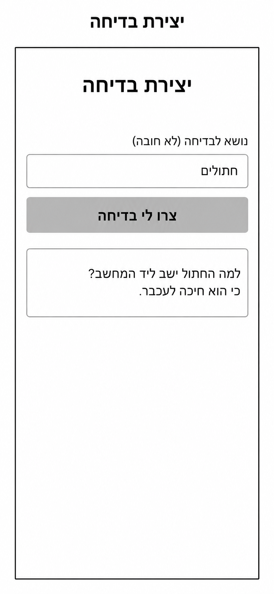
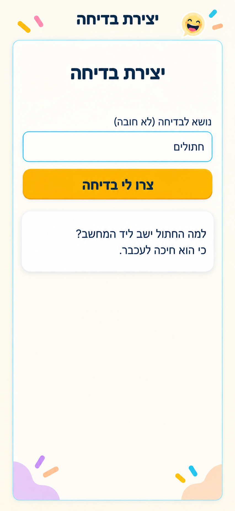
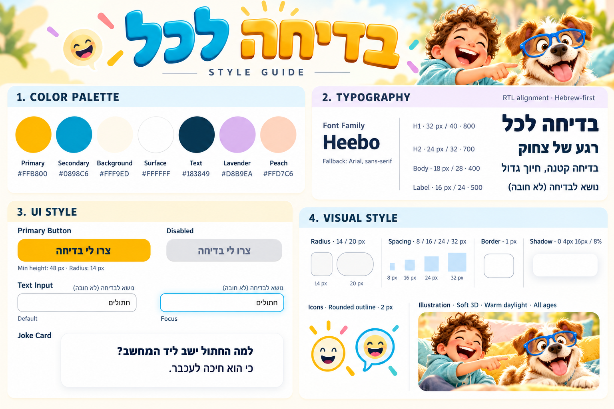

# DESIGN — בדיחה לכל

מסמך עיצוב לממשק Web מותאם למובייל. התכנון מבוסס על ה־PRD, על wireframes.png למבנה, על style-guide.png לשפה העיצובית ועל mockups.png למראה הסופי.

## 1. Screens — מסכי האפליקציה

### יצירת בדיחה

**מטרת המסך:** הזנת נושא אופציונלי, הפעלת יצירת בדיחה וקריאת התוצאה באותו מסך.

זהו המסך היחיד במוצר. ה־Wireframe וה־Mockup מציגים אותו במצב מייצג לאחר יצירה, עם הנושא „חתולים” ובדיחה שהתקבלה. הטקסטים האלה הם תוכן דוגמה ואינם ערכי פתיחה קבועים.

#### מבנה ותוכן

הפריסה אנכית, בעמודה אחת. סדר הרכיבים מלמעלה למטה:

| רכיב | תוכן במקורות | פריסה ומראה |
|---|---|---|
| כותרת המסך | „יצירת בדיחה” | כותרת גדולה ומודגשת, ממורכזת בחלק העליון |
| Label | „נושא לבדיחה (לא חובה)” | מעל שדה הקלט, ביישור לימין |
| Text Input | „חתולים” בדוגמה | שדה לבן רחב, טקסט מיושר לימין, פינות מעוגלות |
| Primary Button | „צרו לי בדיחה” | מתחת לשדה, באותו רוחב, עם טקסט ממורכז |
| Joke Card | „למה החתול ישב ליד המחשב? כי הוא חיכה לעכבר.” | כרטיס לבן מתחת ללחצן, טקסט כהה מיושר לימין ונשבר לשורות |

נשמר מרווח ניכר בין הכותרת לבין הטופס. בין השדה ללחצן ובין הלחצן לכרטיס יש רווחים ברורים. החלק התחתון נשאר מרווח וכולל נגיעות דקורטיביות עדינות בפינות, כפי שמוצג ב־Mockup.

„בדיחה לכל” הוא שם המוצר. הכותרת בתוך המסך נותרת „יצירת בדיחה”, בהתאם ל־Wireframe ול־Mockup; לוגו המותג שבלוח ה־Style Guide אינו מחליף אותה.

#### פעולות וניווט

המשתמש יכול לערוך את הנושא וללחוץ על הלחצן. בדיחה נוספת מוצגת באותו כרטיס ובאותו מסך, לפי ההתנהגות המוגדרת ב־PRD. אין מעבר למסך תוצאה נפרד.

מצבי המתנה ותקלה הם מצבים של המסך הקיים. הודעותיהם נשארות כפי שאושרו ב־PRD: „מכינים לך בדיחה…” ו־„לא הצלחנו ליצור בדיחה. נסו שוב”. ה־Style Guide מספק דוגמת Disabled ללחצן; לא הוגדרו במקורות Mockups נפרדים או צבעי סטטוס ייעודיים להודעות.

#### Wireframes — מקור המבנה

#### Mockups — המראה הסופי

שם המסך שמעל המסגרת בתמונות הוא תווית להצגת התוצר, ואינו כותרת נוספת באתר. מסגרת ה־Viewport מייצגת את גבולות המסך; אין לממש מסגרת Smartphone סביב האתר עצמו.

**מבנה הניווט הכללי:** מסך יחיד ללא תפריט, Tabs או רכיבי ניווט בין עמודים. אין להוסיף רכיבי ניווט מתוך דוגמאות כלליות של מערכת עיצוב.

## 2. Style Guide — השפה העיצובית

### Color Palette

| תפקיד | HEX | שימוש |
|---|---|---|
| Primary | #FFB800 | לחצן הפעולה ונגיעות צהובות |
| Secondary | #0898C6 | הדגשות כחול־טורקיז, קווי מיקוד ונגיעות דקורטיביות |
| Background | #FFF9ED | רקע קרם חם |
| Surface | #FFFFFF | שדה הקלט וכרטיס הבדיחה |
| Text | #183849 | כותרות, תוכן ותווית הלחצן |
| Lavender | #D8B9EA | נגיעות רקע דקורטיביות |
| Peach | #FFD7C6 | נגיעות רקע דקורטיביות |

הרקע בהיר והשימוש בצבעים החזקים ממוקד. תווית הלחצן כהה על צהוב. צבעי Lavender ו־Peach אינם משמשים לציון הצלחה או שגיאה.

ה־Mockup כולל עומק עדין בלחצן, אור רך סביב השדה וצל בכרטיס. קודי ה־HEX הם ערכי הבסיס של ה־Style Guide; לא הוגדרו קודי Gradient Stops מדויקים.

### Typography

Font Family: **Heebo**. Fallback: **Arial, sans-serif**.

| רמה | Font Size | Line Height | Font Weight | שימוש |
|---|---|---|---|---|
| H1 | 32 px | 40 px | 800 | כותרת המסך |
| H2 | 24 px | 32 px | 700 | Token לכותרת משנה ב־Style Guide; אינו מוסיף כותרת למסך הקיים |
| Body | 18 px | 28 px | 400 | טקסט הבדיחה ותוכן שדה הקלט |
| Label | 16 px | 24 px | 500 | תווית השדה |

טקסט הלחצן מודגש כפי שמוצג בדוגמת הרכיב; לא נקבע לו במקורות משקל מספרי נפרד. יש לשמור על היררכיה קריאה לפי ערכי ה־Style Guide, ולא לגזור גדלי CSS ממספר הפיקסלים בתמונה המוגדלת.

### UI Style

**Primary Button:** משטח צהוב, טקסט כהה מודגש וממורכז, Radius של 14 px וגובה מינימלי של 48 px. ה־Mockup מדגים עומק עדין בקצה התחתון. דוגמת Disabled ב־Style Guide משתמשת ברקע אפור בהיר ובטקסט אפור עמום; לא הוגדרו לה קודי HEX.

**Text Input:** משטח לבן, Radius של 14 px, Label חיצוני מעל השדה ויישור תוכן לימין. דוגמת Default כוללת Border אפור דק; דוגמת Focus כוללת הדגשה בכחול־טורקיז, כפי שנראית גם ב־Mockup. הדגשת Focus תעקוב אחר המיקוד בפועל ולא תוצג כמצב קבוע.

**Joke Card:** משטח לבן, Radius של 20 px, גבול עדין וצל רך. הטקסט אינו כפתור ואין בכרטיס פעולות נוספות. גובה הכרטיס יאפשר לטקסט להישבר לשורות; אין לחתוך בדיחה כדי לשחזר את גובה דוגמת התמונה.

**Icons:** השפה המוגדרת היא Rounded Outline בעובי 2 px, עם מוטיבים של חיוך ובועת דיבור. ב־Mockup החיוך וקווי הקונפטי הם קישוט בלבד; אין להעניק להם פעולה או משמעות של ניווט.

### Visual Style

- **אווירה:** בהירה, שמחה, חמה ומשפחתית, עם צהוב וכחול־טורקיז על משטחים רגועים.
- **צורות:** פינות מעוגלות, קימורים רכים ונגיעות צבע אורגניות בפינות התחתונות.
- **Border:** עובי בסיס של 1 px לפי ה־Style Guide.
- **Shadow:** ערך הבסיס המוצג הוא 0 4px 16px בעוצמה של 8%; אין במקורות צבע צל מדויק.
- **Spacing:** סולם של 8, 16, 24 ו־32 px. יש להשתמש בו לריווח רכיבים ול־Padding, תוך שמירה על היחסים והמרווחים שב־Mockup; לא נקבע במקורות מיפוי מספרי לכל רווח.
- **Layout:** עמודה אחת עם רוחב אחיד לשדה וללחצן, וכרטיס תוצאה רחב מתחתיהם. נשמרים שוליים צדדיים ומרחב ריק מתחת לתוכן.
- **Responsive:** יחס מסגרת המובייל בתמונות הוא בקירוב 9:19.5. זהו Viewport מייצג, לא גובה קבוע לאתר. התוכן צריך להתאים לרוחב הזמין ולהישאר נגיש כשהטקסט ארוך או המקלדת פתוחה.
- **Illustration:** ה־Style Guide מגדיר Soft 3D עם Warm Daylight ואופי המתאים לכל הגילים. תמונת המשפחה והכלב היא דוגמת Art Direction; אין ב־Mockup אזור Hero או תמונת תוכן, ולכן אין להוסיף אותם למסך.

### שפה וכיווניות

הממשק בעברית וב־RTL. Label, ערך השדה וטקסט הבדיחה מיושרים לימין; כותרת המסך ותווית הלחצן ממורכזות בהתאם למקורות. פיסוק וירידות שורה יוצגו בסדר עברי תקין. שמות הקטגוריות באנגלית שבלוח ה־Style Guide הם תיעוד מקצועי בלבד ואינם תוכן UI של האפליקציה.
